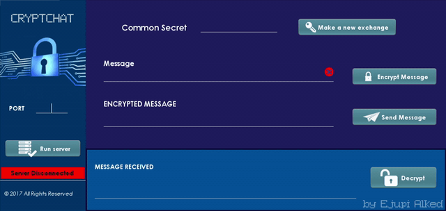

# CryptChat

> ⚠️ **Note (2026):** I built this in 2017, in my final year of high school, while first learning to code. It works and demonstrates a Diffie-Hellman + AES handshake, but it is **not secure by modern standards** (AES in ECB mode, unauthenticated key exchange, no TLS, key material logged, no proper key derivation). I'm keeping it as a learning artifact from when I was starting out. See [SECURITY_NOTES.md](SECURITY_NOTES.md) for a full self-audit.

CryptChat is an encrypted chat between an Android client and Java server that uses the Diffie-Hellman algorithm for the exchange of public keys and the AES algorithm for the encryption/decryption of messages. The public key carries different parameters which can be seen by anyone, it is needed to generate a common secret key. Both client and server generate a key pair: the public key mentioned before, and a private key. Each side's private key is used only to compute a common secret key via the Diffie-Hellman algorithm; a shared AES key is derived from that secret and used to both encrypt and decrypt every message. The messages sent over the network socket are encoded in BASE64.

Client             |  Server
:-------------------------:|:-------------------------:
  | 

## Background
I originally built and presented CryptChat in high school for a project on Computer Security, while I was learning programming. As the note at the top explains, it still falls short of modern security standards.

## How to run the project

**Requirements:** JDK 8+ for the server, Android Studio (min SDK 23) for the client.

1. **Server** — open [`server/pom.xml`](server/pom.xml) in IntelliJ as a Maven project, run [`ServerApplication`](server/src/main/java/ServerApplication.java), and start the server on a port of your choice from its window.
2. **Client** — open [`client`](client) in Android Studio, run the app on a device or emulator, then connect using the server's IP address and the same port.

The client and server must be on the same network.
